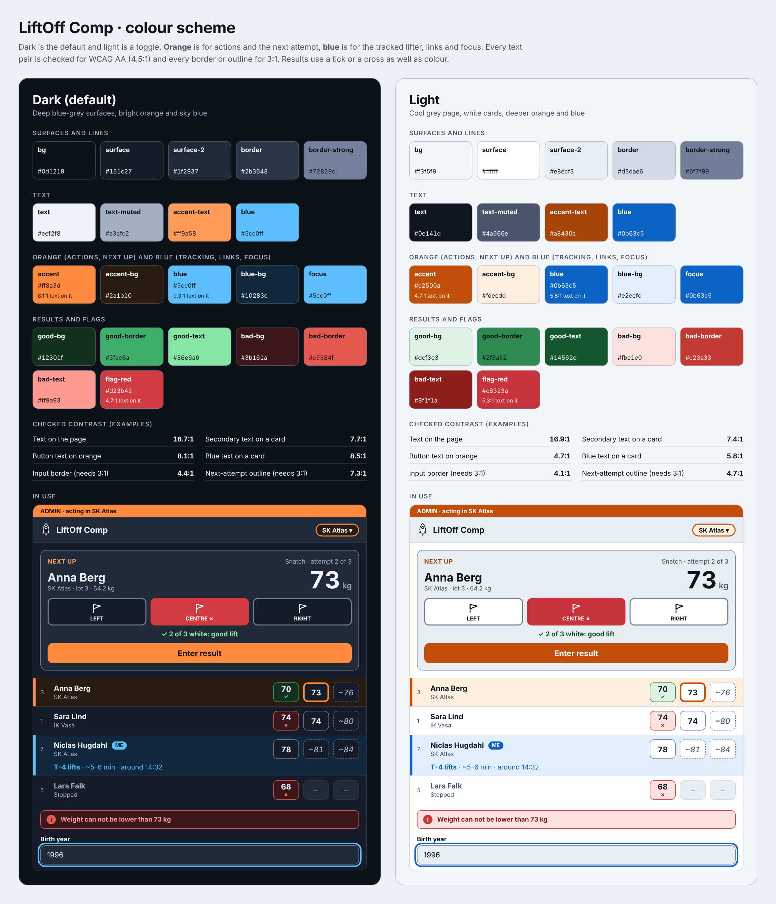

# LiftOff Comp

**Know when you're up.**

Frontend project from C#.NET fullstack course with Lexicon

<!-- TODO: take an "Am I Responsive" screenshot when the app is finished -->

Link to live website: TODO

## Table of contents

* [User Experience (UX)](#user-experience-ux)
    * [User stories](#user-stories)
        * [Project goals](#project-goals)
        * [User goals](#user-goals)
* [Design](#design)
    * [Colours](#colours)
    * [Typography](#typography)
    * [Images and icons](#images-and-icons)
    * [Wireframes](#wireframes)
    * [Accessibility](#accessibility)
* [Features](#features)
    * [Login](#login)
    * [Clubs and accounts](#clubs-and-accounts)
    * [Competitions and groups](#competitions-and-groups)
    * [Adding lifters](#adding-lifters)
    * [The group board](#the-group-board)
    * [The next lifter and the plates](#the-next-lifter-and-the-plates)
    * [Judge flags and results](#judge-flags-and-results)
    * [Time estimate (T-minus)](#time-estimate-t-minus)
    * [Always up to date](#always-up-to-date)
    * [Lifters and previous competitions](#lifters-and-previous-competitions)
    * [Light and dark mode](#light-and-dark-mode)
* [Future features](#future-features)
* [Technologies used](#technologies-used)
    * [Languages](#languages)
    * [Frameworks & Tools](#frameworks--tools)
* [Testing](#testing)
* [Deployment](#deployment)
    * [Local development](#local-development)
* [Credits](#credits)
    * [Content](#content)
    * [Media](#media)
    * [Code](#code)

## User Experience (UX)

LiftOff Comp is a web app for Olympic weightlifting competitions. It answers one question that every lifter asks while waiting for their turn: **"How long until it is my turn to lift?"** Knowing this makes it possible to time warm-up lifts, food and drink.

A coach (or the lifter) enters everyone in a group, their weigh-in result and their opening weights. The app estimates the second and third attempts, keeps the lifting order, and counts down the lifts before the lifter they follow. When judges' flags are entered the app learns the real pace of the competition, and the estimate gets better. Everything is saved, so lifters and coaches can look back at previous competitions.

### User stories

#### Project goals
- Answer "how many lifts and how many minutes until my turn?" at a glance
- Make entering a result fast enough to keep up with a real competition
- Keep a reliable record of every attempt, including which judge gave which flag
- Keep each club's data separate from other clubs
- Keep every open screen up to date without anyone refreshing
- Work well on a phone or tablet in a busy competition hall
- Be accessible and easy to read in both a dark and a light environment

#### User goals
- **As a lifter** I want to know roughly how many minutes until I lift, so I can plan my warm-up and food.
- **As a coach** I want to follow two athletes in the same group, so I can time both warm-ups.
- **As a coach** I want to enter the three judge flags for each attempt, so the result is correct and recorded.
- **As a coach** I want to correct a weight or a result afterwards, so a mistake does not ruin the record.
- **As a coach** I want to see which judge usually gives a red flag to an athlete, so I know what to work on.
- **As a coach** I want to restore a lifter I removed by mistake.
- **As a coach** I want the next lifter to change by itself when a lifter raises their weight, so the screen always shows who is up.
- **As a coach** I want a weight that breaks the weight rules to be refused with a clear message, and later attempts to move up by themselves when I raise an earlier one, so the weights always follow the rules.
- **As a coach** I want the screen to update by itself when another coach enters a result, so nobody works with old information.
- **As an admin** I want to create clubs and coaches and edit the data of any club, so I can help a club get started.
- **As a lifter** I want to see how I and my competitors did in previous competitions.

TODO: update the stories when the final features are decided.

## Design

### Colours

TODO: colour scheme (dark and orange with a special blue accent, plus a light mode).

<!-- TODO: create colour scheme image -->

### Typography

TODO: fonts and why they were chosen.

### Images and icons

TODO: the rocket icon, the T-minus display and the plate graphics (SVG).

### Wireframes

TODO: describe how the wireframes changed into the final design.

Wireframe of the group board
 

 

<!-- TODO: add the other wireframes when they are drawn -->

### Accessibility

TODO: describe what was done. Planned: semantic HTML (real table for the lifter list), flags and results that do not rely on colour alone, keyboard support for editing weights, live region for the next lifter, large tap targets, visible focus, contrast checked in both themes.

Screenshot of the responsive behaviour from phone to tablet to computer
 

 

<!-- TODO: take screenshots -->

## Features

### Login

TODO: describe the login and how accounts are created.

Screenshot of the login page
 

 

<!-- TODO: take screenshot -->

### Clubs and accounts

TODO: describe the admin (full access, club switcher), coaches (their own club) and how new accounts are created.

Screenshot of the members page and the club switcher
 

 

<!-- TODO: take screenshot -->

### Competitions and groups

TODO: describe creating a competition (date or date span) and adding groups. Groups can mix men and women.

Screenshot of the competitions page
 

 

<!-- TODO: take screenshot -->

### Adding lifters

TODO: describe the form, suggestions from earlier competitions and the automatic 4 % and 8 % weights.

Screenshot of the add lifter form
 

 

<!-- TODO: take screenshot -->

### The group board

TODO: describe the lifter table, the order, the colours, editing a weight by clicking it, and stopping, withdrawing and restoring a lifter.

Screenshot of the group board
 

 

<!-- TODO: take screenshot -->

### The next lifter and the plates

TODO: describe the next-lifter panel inspired by the competition monitors and the plate diagram.

Screenshot of the next lifter panel
 

 

<!-- TODO: take screenshot -->

### Judge flags and results

TODO: describe the three flags (left, centre, right), the two-of-three rule and why the order of the flags matters.

Screenshot of the flag buttons
 

 

<!-- TODO: take screenshot -->

### Time estimate (T-minus)

TODO: describe the tracked lifter ("ME"), the number of lifts before the start of the competition, the minute range after the start, and how the pace is estimated.

Screenshot of the T-minus estimate
 

 

<!-- TODO: take screenshot -->

### Always up to date

TODO: describe the automatic refresh about every 15 seconds, the "Updated … ago" indicator, and what happens when the connection is lost.

Screenshot of the refresh indicator
 

 

<!-- TODO: take screenshot -->

### Lifters and previous competitions

TODO: describe the lifter detail page (competitions, flags per lift, Sinclair) and the competition history.

Screenshot of the lifter page
 

 

<!-- TODO: take screenshot -->

### Light and dark mode

TODO: describe the theme toggle.

Screenshot of light and dark mode
 

 

<!-- TODO: take screenshot -->

## Future features

- Accounts for lifters, created by their coach, with personal warm-up and 1RM records
- A warm-up page with the weightlifting calculator from my earlier project
- A read-only live view for lifters on their own phone
- Offline support for halls with a bad connection
- A smarter estimate that expects a repeated weight after a no-lift
- Weight classes and age classes (for example W40), with the winner of each class in the results of previous competitions
- Groups that only allow men or only women
- Export of results

TODO: update at the end.

## Technologies used

### Languages
- TypeScript
- HTML
- Sass / CSS
- SQL (through Prisma)

### Frameworks & Tools
- Next.js and React
- Prisma ORM and PostgreSQL (Neon)
- Better Auth
- Zod
- Vitest and React Testing Library
- Git and GitHub
- Vercel
- VS Code and Claude Code
- TODO: wireframe tool, icon source, font source, image converter

## Testing

Testing is described in a separate file: [TESTING.md](TESTING.md)

TODO: create TESTING.md in the last phase.

## Deployment

TODO: describe the deployment to Vercel with a Neon database (environment variables, migrations, first user).

Link to live website: TODO

### Local development

TODO: fill in when the project is scaffolded.

Planned steps:
- Install Node.js 22.18 or later
- Clone the repository and run `npm install`
- Copy `.env.example` to `.env` and fill in the values
- Create the database tables and the first coach with the Prisma migration and seed scripts
- Start the app with `npm run dev`

## Credits

### Content

TODO: Sinclair coefficients are published by the International Weightlifting Federation (IWF).

### Media

TODO: rocket icon source, plate graphics (from my own Weightlifting Calculator project), fonts.

### Code

TODO: code taken from my earlier project [Weightlifting Calculator](https://github.com/NiclO1337/weightlifting-calculator) (plate calculation and plate graphics), documentation and guides used.
